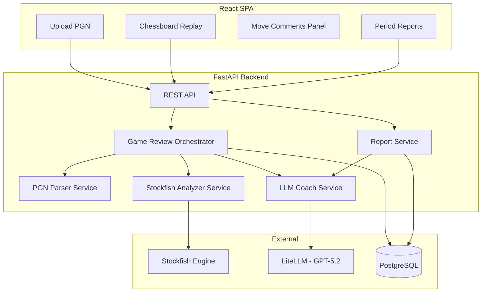
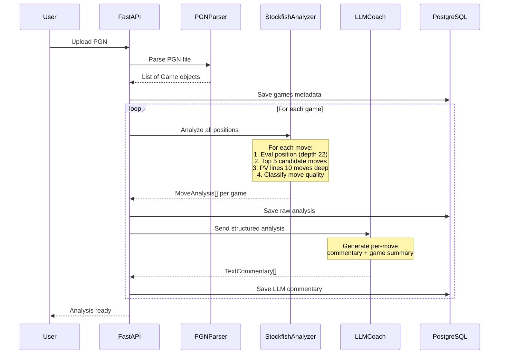
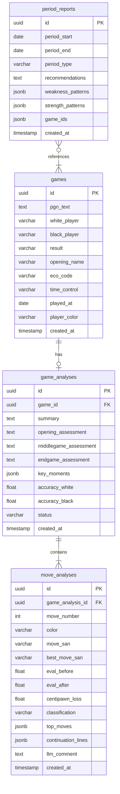

# Chess Coach LLM Agent -- План разработки

## Архитектура




## Data Flow -- анализ одной партии




## Стек технологий

### Backend (Python)

- **FastAPI** -- REST API
- **python-chess** -- PGN-парсинг, работа с позициями, интеграция со Stockfish через `chess.engine`
- **Stockfish** -- шахматный движок (бинарник, вызывается через python-chess UCI)
- **LiteLLM** -- абстракция для LLM (GPT-5.2)
- **SQLAlchemy 2.0** -- ORM (async)
- **Alembic** -- миграции БД
- **Pydantic v2** -- валидация и сериализация
- **Celery + Redis** -- фоновые задачи (анализ партий тяжёлый, 1-5 мин на партию)
- **UV** -- управление зависимостями (по правилам проекта)
- **Ruff** -- линтинг и форматирование

### Frontend

- **React 18** + **TypeScript**
- **react-chessboard** -- интерактивная доска
- **chess.js** -- логика шахмат на клиенте (валидация, навигация)
- **TanStack Query** -- управление серверным состоянием
- **Tailwind CSS** -- стилизация
- **Vite** -- сборка

### Infrastructure

- **PostgreSQL 16** -- основная БД
- **Redis** -- брокер задач для Celery
- **Docker Compose** -- локальный стек (Postgres, Redis, Stockfish)

---

## Структура проекта

```
chess-master/
├── src/
│   └── app/
│       ├── __init__.py
│       ├── main.py                    # FastAPI app factory
│       ├── core/
│       │   ├── config.py              # Settings (Pydantic BaseSettings)
│       │   ├── database.py            # Async SQLAlchemy engine/session
│       │   └── dependencies.py        # FastAPI DI
│       ├── models/
│       │   ├── game.py                # Game SQLAlchemy model
│       │   ├── move_analysis.py       # MoveAnalysis model
│       │   ├── game_analysis.py       # GameAnalysis (summary) model
│       │   └── period_report.py       # PeriodReport model
│       ├── schemas/
│       │   ├── game.py                # Pydantic schemas for API
│       │   ├── analysis.py
│       │   └── report.py
│       ├── services/
│       │   ├── pgn_parser.py          # PGN parsing via python-chess
│       │   ├── stockfish_analyzer.py  # Stockfish analysis engine
│       │   ├── llm_coach.py           # LLM commentary generation
│       │   ├── game_review.py         # Orchestrator: parse -> analyze -> LLM
│       │   └── report.py              # Period report generation
│       ├── api/
│       │   ├── router.py              # Main router
│       │   ├── games.py               # /api/games endpoints
│       │   ├── analysis.py            # /api/analysis endpoints
│       │   └── reports.py             # /api/reports endpoints
│       ├── tasks/
│       │   └── analysis.py            # Celery tasks for async analysis
│       └── utils/
│           ├── chess_helpers.py        # Move classification, FEN utils
│           └── llm_prompts.py         # Prompt templates for LLM coach
├── tests/
│   ├── conftest.py
│   ├── test_pgn_parser.py
│   ├── test_stockfish_analyzer.py
│   ├── test_llm_coach.py
│   └── test_api/
├── frontend/                          # React app (отдельный package.json)
│   ├── src/
│   │   ├── components/
│   │   │   ├── ChessBoard.tsx         # Board wrapper
│   │   │   ├── MoveList.tsx           # Move list with classifications
│   │   │   ├── CommentaryPanel.tsx    # LLM commentary per move
│   │   │   ├── GameUpload.tsx         # PGN upload form
│   │   │   └── ReportView.tsx         # Period reports
│   │   ├── pages/
│   │   ├── hooks/
│   │   └── api/
│   └── package.json
├── alembic/
│   └── versions/
├── pyproject.toml
├── uv.lock
└── docker-compose.yml
```

---

## Схема БД




---

## Ключевые сервисы -- детали реализации

### 1. StockfishAnalyzerService (`src/app/services/stockfish_analyzer.py`)

Ядро системы. Для каждого хода:

- Оценка позиции на глубине 22 (или time limit 5 сек)
- Получение top-5 ходов через `engine.analyse(board, limit, multipv=5)`
- Для каждого кандидата -- PV-линия на 10 ходов вперёд
- Классификация хода игрока по centipawn loss:
  - `|cp_loss| < 10` -- best
  - `|cp_loss| < 30` -- good
  - `|cp_loss| < 50` -- inaccuracy
  - `|cp_loss| < 100` -- mistake
  - `|cp_loss| >= 100` -- blunder

### 2. LLMCoachService (`src/app/services/llm_coach.py`)

Работает через LiteLLM. Три режима промптов:

- **Per-move commentary**: получает FEN, ход игрока, лучший ход движка, continuation lines, классификацию. Генерирует объяснение на 2-5 предложений.
- **Game summary**: получает все классификации ходов, ключевые моменты, opening/middlegame/endgame фазы. Генерирует сводку партии.
- **Period report**: получает сводки N партий за период. Выявляет паттерны ошибок, сильные стороны, даёт рекомендации для прогресса.

Промпты хранятся в `src/app/utils/llm_prompts.py` как шаблоны.

### 3. GameReviewService (`src/app/services/game_review.py`)

Оркестратор, управляет пайплайном:

1. Принимает PGN
2. Вызывает `PGNParserService` для парсинга
3. Запускает Celery-задачу для `StockfishAnalyzerService`
4. По завершении Stockfish-анализа передаёт данные в `LLMCoachService`
5. Сохраняет всё в БД
6. Уведомляет фронтенд о готовности (WebSocket или polling)

---

## API Endpoints

- `POST /api/games/upload` -- загрузка PGN (один или несколько файлов)
- `GET /api/games` -- список партий (фильтры: дата, результат, opening)
- `GET /api/games/{id}` -- детали партии
- `GET /api/games/{id}/analysis` -- полный анализ с комментариями к каждому ходу
- `GET /api/games/{id}/analysis/status` -- статус анализа (pending/in_progress/done)
- `POST /api/reports` -- генерация отчёта за период (body: start, end, period_type)
- `GET /api/reports/{id}` -- получение отчёта

---

## Frontend -- ключевые экраны

1. **Game Library** -- таблица партий, фильтры, кнопка Upload
2. **Game Viewer** -- главный экран:
  - Шахматная доска (react-chessboard) с анимацией ходов
  - Список ходов с цветовой индикацией (зелёный=best, жёлтый=inaccuracy, оранжевый=mistake, красный=blunder)
  - Панель комментария -- LLM-текст для текущего хода
  - Стрелки на доске для лучших ходов движка
  - Навигация: first/prev/next/last/autoplay
  - Eval bar (оценка позиции движком)
3. **Reports** -- сводки за период с рекомендациями

---

## Порядок разработки (фазы)

**Фаза 1 -- Foundation**: инициализация проекта, pyproject.toml, Docker Compose (Postgres + Redis), структура каталогов, модели БД, Alembic миграции, базовый FastAPI app.

**Фаза 2 -- Core Engine**: PGN-парсер, Stockfish-анализатор, сохранение результатов в БД. Celery для фоновых задач.

**Фаза 3 -- LLM Coach**: интеграция LiteLLM, промпты для per-move/game/period анализа, генерация текстовых комментариев.

**Фаза 4 -- API Layer**: REST endpoints для загрузки, получения анализа, генерации отчётов.

**Фаза 5 -- Frontend**: React app, шахматная доска, навигация по ходам, панель комментариев, загрузка PGN, список партий.

**Фаза 6 -- Reports**: агрегированная аналитика за период, рекомендации по прогрессу.

**Фаза 7 -- Polish**: тесты, обработка ошибок, оптимизация производительности Stockfish, streaming LLM ответов.